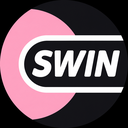

  

<h1 align="center">Swinline для SLAY</h1>

<strong>Буки лезут в номинации, мы лезем в их баннеры и рисуем пятачки. 🐽</strong>

  <a href="https://github.com/oSERGRAYo/swinline/releases/download/v0.2.9/Swinline-0.2.9.zip"><strong>Скачать Swinline 0.2.9</strong></a>
  · <a href="#установка">Как установить</a>
  · <a href="https://github.com/oSERGRAYo/swinline/releases">Все релизы</a>

Swinline — независимая пародия на букмекерскую рекламу в стриминге. Расширение
для Chrome и Edge рисует пятачок на месте логотипа Winline, перекрашивает
оранжевые акценты и скрывает прямые ссылки на букмекера на сайте SLAY.

## Скриншоты

**Главный экран** с розовыми кристаллами и пятачком в логотипе SWINLINE.

**Номинации** с розовыми коронами, заголовками и кнопками голосования.

Снято в Chromium со Swinline 0.2.9 на локально воспроизведённых секциях SLAY.

## Установка

1. Скачайте [Swinline-0.2.9.zip](https://github.com/oSERGRAYo/swinline/releases/download/v0.2.9/Swinline-0.2.9.zip)
   и распакуйте его в отдельную папку. При установке из исходников используйте папку `extension/`.
2. Откройте `chrome://extensions` или `edge://extensions` и включите режим разработчика.
3. Нажмите «Загрузить распакованное расширение» и выберите папку, в которой лежит `manifest.json`.
4. Откройте [номинации SLAY](https://slay-award.ru/#nominations) или обновите уже открытую вкладку.

Чтобы вернуть исходный вид сайта, отключите расширение и обновите вкладку.

## Возможности

Что именно меняет Swinline

- Перекрашивает насыщенные оранжевые оттенки на страницах `slay-award.ru`.
  Это касается оранжевых деталей фотографий, фонов, градиентов, кнопок и
  форм. Остальные цвета сохраняются.
- Заменяет оранжевые значения непосредственно в стилях страницы. Розовая
  палитра действует на градиенты, тени, рамки и кадры CSS-анимаций.
- На главной отдельно обрабатывает красно-оранжевые грани кристаллов,
  стрелки, значки номинаций, фон
  золотого билета и тёмную подсветку портретов победителей.
- Перекрашивает кристальные кнопки по общему компоненту SLAY. Розовый цвет
  применяется к фону и видеоэффекту, включая состояние «Изменить выбор»
  после голосования.
- Красит кристаллы на заставке и стрелки, которые сайт рисует через CSS.
  Заголовки номинаций и слайдов используют один розовый градиент,
  в том числе при смене карточек.
- Подмена названия и графики Swinline применяется на главной странице,
  в том числе в разделе `#nominations`.
- Подменяет отдельный логотип Winline векторным Swinline с прозрачными
  отверстиями в пятачке. Для заставки, главного баннера, золотого билета и трёх
  фотографий с церемонии использует локальные PNG.
- Показывает оригинальную анимацию первого экрана с приглушённым розовым
  освещением и логотипом SWINLINE в исходной белой рамке. Версия ролика
  выбирается по ширине экрана.
  Стоп-кадр используется при загрузке и в режиме уменьшенного движения.
- Меняет Winline на Swinline в тексте и подписях, включая элементы,
  которые появляются после загрузки страницы.
- Скрывает прямые ссылки на `winline.ru` и его поддомены. Рекламная картинка,
  которая сама служит ссылкой, получает замену без перехода на Winline.
  Оба правила действуют и для элементов, появившихся после загрузки.
- Применяет правки к отображению страницы в браузере пользователя.

## Документы

| Документ | Что в нём |
| --- | --- |
| [Архитектура](docs/architecture.md) | Правила замены картинок, фильтрация ссылок, структура файлов и работа с динамической страницей |
| [План реализации и проверки](docs/implementation-plan.md) | Порядок разработки, критерии готовности и проверка на живом сайте |

## Статус проекта

Swinline — независимый сатирический проект без связи с Winline и организаторами
SLAY. Названия этих проектов указывают на предмет пародии и сайт, для которого
сделано расширение. Изменения отображаются в браузере пользователя.

## Гарантии и ответственность

Расширение предоставляется «как есть», без гарантий бесперебойной работы,
совместимости с будущими версиями браузеров или сайта SLAY и пригодности для
конкретной цели. Установка добровольна. Пользователь сам решает, когда включать
расширение и полагаться ли на отображаемую им информацию.

В пределах, допускаемых применимым законодательством, автор не несёт
ответственности за убытки вследствие использования расширения или невозможности
его использования. Обязательные требования закона действуют в полном объёме.

## Лицензия и сторонние материалы

Авторский код Swinline доступен по [лицензии MIT](LICENSE). Её действие
ограничено оригинальным кодом проекта. Логотипы, товарные знаки, иконки,
изображения, ролики и другие медиафайлы находятся за пределами этой лицензии.
Права на исходные материалы SLAY и Winline принадлежат соответствующим
правообладателям. При повторном использовании медиа применяются условия
правообладателей и требования закона.

По вопросам использования конкретного материала можно открыть [обсуждение в Issues](https://github.com/oSERGRAYo/swinline/issues)
и указать файл или ссылку на релиз. Для формальных обращений доступны процедуры
GitHub по [авторским правам](https://docs.github.com/en/site-policy/content-removal-policies/dmca-takedown-policy)
и [товарным знакам](https://docs.github.com/en/site-policy/content-removal-policies/github-trademark-policy).
