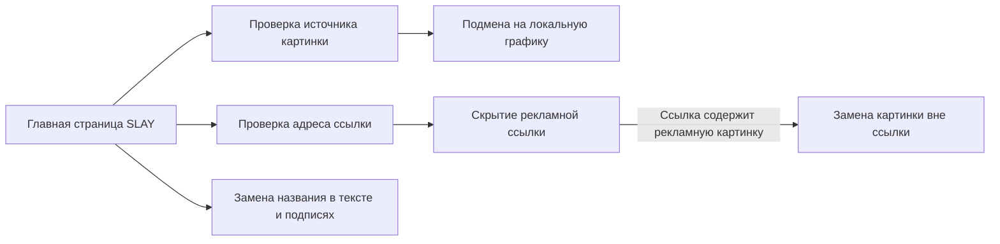

# Архитектура

Первая версия — расширение Manifest V3 на обычных JavaScript и CSS, которое
можно загрузить из папки без сборки. Скрипт меняет название в тексте и
подписях, подбирает PNG и проверяет адреса ссылок. Таблица стилей отображает
розовую графику и скрывает помеченные рекламные ссылки.

## Что известно о сайте

В публичном представлении [страницы SLAY Award](https://slay-award.ru/#nominations),
проверенном 16 ноября 2026 года, виден логотип Winline в верхней части страницы
и рядом с содержимым окон голосования. В обоих случаях указан один ресурс
на `static.slay-award.ru`, в пути которого встречается `/_astro/winline.`.
На странице также есть текстовые упоминания Winline.

Также название встроено в графику заставки, главного баннера и золотого
билета, а на трёх фотографиях видна плашка спонсора. Для прямых ссылок
домен сопоставления — `winline.ru`. [Официальный сайт Winline](https://winline.ru/)

## Компоненты

```text
extension/
  manifest.json          # Адрес страницы и подключение JS и CSS
  content.css             # Стили подмены изображений и скрытия ссылок
  theme.css               # Подключение цветового фильтра
  theme.js                # Фильтр оранжевых оттенков
  palette.js              # Замена цветов в CSS страницы
  content.js              # Правила сопоставления и обработка изменений DOM
  assets/replacements/    # Локальные PNG и ролики первого экрана
```

Для запуска расширения достаточно папки `extension/`.



## Подключение

Манифест объявляет статический `content_scripts` с `css: ["content.css"]`,
`js: ["content.js"]`, `run_at: "document_start"` и `all_frames: false`. Для
главной страницы используются шаблоны `https://slay-award.ru/` и
`https://slay-award.ru/?*`: второй покрывает параметры запроса. Фрагмент
`#nominations` относится к тому же документу, поэтому в шаблонах его нет.
Скрипт работает в изолированном окружении браузера.
[Подключение скриптов страницы](https://developer.chrome.com/docs/extensions/develop/concepts/content-scripts),
[шаблоны адресов и фрагменты](https://developer.mozilla.org/en-US/docs/Mozilla/Add-ons/WebExtensions/Match_patterns).

Доступ к странице задаётся этими шаблонами. Дополнительные `permissions` и
`host_permissions`, фоновый процесс, сервер и хранилище для первой версии
не нужны. Включение и отключение выполняются в менеджере расширений браузера.
В `web_accessible_resources` перечислить файлы подмены, доступные источнику
`https://slay-award.ru/*`. Скрипт получает их адреса через
`chrome.runtime.getURL()`. [Документация Chrome](https://developer.chrome.com/docs/extensions/reference/manifest/web-accessible-resources).

## Замена оранжевых оттенков

Отдельное правило манифеста подключает `palette.js`, `theme.css` и
`theme.js` на всех путях `https://slay-award.ru/*`.
`palette.js` заменяет исходные цвета в CSS: в стопах градиентов, тенях,
рамках, состояниях элементов и кадрах анимаций. Ключевые цвета темы
привязаны к одной розовой палитре. Прозрачность и приоритет деклараций
сохраняются.

Для таблицы стилей CDN браузер загружает копию в том же месте каскада с
разрешённым анонимным CORS. Она применяется после обработки правил.
Если чтение копии недоступно, остаётся исходная таблица стилей.
Встроенные правила и атрибуты стилей обрабатываются напрямую.

SVG-фильтр выделяет насыщенные
оранжевые пиксели в отрисованной странице и плавно подмешивает розовый
у границ диапазона. Цвет `#ff6a00` переходит в `#ffa8c5`. Фильтр
применяется к фотографиям, градиентам и интерфейсу, включая нативные
диалоги и всплывающие элементы. [Спецификация SVG-фильтров](https://www.w3.org/TR/filter-effects-1/)

Решение оставляет стили элементов управления сайту, включая наведение,
выбор и фокус. Приглушённые оттенки, включая типичные тона кожи,
исключаются по насыщенности. В системном режиме принудительных цветов
применяется системная палитра.

Для кристаллов нужен более широкий диапазон от тёплого красного до золотого.
На главной `content.js` помечает подтверждённые декоративные ресурсы,
а также область заставки, которую находит по логотипу «Swinline Slay».
Правило для стрелок охватывает
как изображения, так и ресурсы, заданные стилями элемента или его
псевдоэлемента. После загрузки таблиц стилей ссылки на графику проверяются
повторно.

Кристальные кнопки определяются по общему классу `.button-gem`. Фильтр
действует на фоновый слой `::before` и видео `.button-gem__fx`.
Поскольку после голосования сайт обновляет только подпись той же кнопки,
«Изменить выбор» получает то же оформление. Класс также используется в
модальных окнах и на странице аккаунта. Светлая подпись получает тёмную
тень, а серый каменный вариант сохраняет свои стили.

У портретов победителей
подсветка встроена в сам файл, поэтому у них отдельный фильтр с порогом по
яркости и насыщенности. Обычные фотографии используют общий фильтр.

Заголовки «Номинации 2026» и «Stream Legends Awards of the Year» получают
градиент непосредственно в CSS. Он применяется и к вложенным строкам.
У заголовков сохраняются переходы прозрачности и трансформации. Цвета
букв определяются одним градиентом на протяжении перехода.

## Правила фильтрации

| Цель | Условие | Действие |
| --- | --- | --- |
| Текст и подписи | Отдельное слово Winline в любом регистре. | Показать «Swinline» в текстовом узле, `alt`, `aria-label`, `aria-description`, `title` или `placeholder`. |
| Отдельный логотип | Известный адрес. | Показать SVG Swinline с прозрачными отверстиями в пятачке. |
| Заставка | Известная подпись. | Показать PNG Swinline SLAY. |
| Winline внутри картинки | Подтверждённый оригинал с логотипом или надписью в пикселях изображения. | Показать обработанный PNG с тем же сюжетом. |
| Фоновая картинка | Известный адрес в атрибуте `style`. | Заменить нужный слой `background-image`. |
| Видео первого экрана | `video.hero__video` с известным адресом ролика SLAY. | Подменить источник на обработанный MP4 и обновить стоп-кадр. |
| Прямая ссылка | Элемент `a[href]` ведёт по HTTP(S) на `winline.ru` или его поддомен. | Поставить атрибут `data-swinline-ad`, по которому CSS применяет `display: none !important`. |
| Рекламная картинка внутри такой ссылки | Проверенная ссылка служит обёрткой для рекламного изображения. | Скрыть ссылку, а замену показать в том же месте отдельным элементом без ссылки. |

В таблице `assetFiles` ключом служит имя файла с `static.slay-award.ru`
до хеша сборки, например `winline` или `hero-2560`. Оба известных размера
резервной картинки первого экрана используют кадр из обновлённого ролика.
Для заставки загрузки правило проверяет
точную подпись «Winline Slay». Подменой текста управляет один скрипт,
который работает с отдельными текстовыми узлами и обходит поля с вводом пользователя.

Для первого экрана используются две версии оригинальной анимации SLAY
по 16 секунд в 24 кадра в секунду. В роликах настроены цвет и яркость. Исходная
белая рамка обводит наклонную надпись SWINLINE и пятачок, который открывает фон
в двух отверстиях. Расширение заменяет
адреса в имеющихся `source`, сохраняя условие для мобильного экрана.
Воспроизведением, кадрированием и режимом уменьшенного движения управляет
сайт.

Для `img` использовать `currentSrc` после выбора источника браузером
и `src` для простых изображений до загрузки. Это позволяет учесть
`srcset` и `picture` и сопоставлять реально выбранный вариант, когда
на разных ширинах экрана используются разные картинки. Скрипт передаёт
адрес замены в CSS, а CSS отображает его через `content: url(…)` на том же
элементе. Для известных фонов CSS меняет конкретный слой. В обоих случаях
сохраняются заданные сайтом размеры и обновляется доступное описание.
[`currentSrc`](https://developer.mozilla.org/en-US/docs/Web/API/HTMLImageElement/currentSrc),
[`content`](https://developer.mozilla.org/en-US/docs/Web/CSS/Reference/Properties/content).

Для ссылок разобрать непустой `href` через `new URL(href, document.baseURI)`.
Сравнивать `hostname` в нижнем регистре, убрав завершающую точку, если она
есть: точное совпадение с `winline.ru` или окончание на `.winline.ru`.
Так `notwinline.ru`, `winline.ru.example.org` и упоминание домена в параметре
другого URL не совпадут. Некорректный URL и схемы помимо HTTP(S) пропустить.
При смене адреса на обычный снять отметку и убрать отдельную графическую
замену ссылки, если она создавалась. Если рекламная картинка ведёт на
внутренний раздел SLAY, заменить картинку внутри ссылки и сохранить переход.
Правила для стороннего редиректа добавляются по проверенному адресу.

В окне голосования правило применяется непосредственно к картинке,
чтобы заголовок, содержимое и кнопки оставались доступны.

## Жизненный цикл скрипта

1. Подписаться через один `MutationObserver` на `document` с
   `childList: true`, `subtree: true`, `characterData: true` и фильтром
   атрибутов адресов, изображений и подписей. Затем обработать доступные
   текст, ссылки и картинки.
2. Собирать кандидатов из добавленных поддеревьев и изменённых узлов.
   При изменении `source` перепроверять связанный `img` внутри `picture`.
   События `load` и `error` на изображениях отслеживать на этапе захвата,
   чтобы перепроверить `currentSrc` после выбора ресурса браузером.
   При добавлении, удалении или изменении `base[href]` повторно разрешить
   относительные адреса.
3. Обновлять отметки и графику только при смене результата. Когда
   картинка перестаёт соответствовать правилу, убрать её подмену. Хранить
   связь рекламной ссылки с её отдельной заменой, чтобы обновлять её и
   очищать при удалении ссылки из DOM. При обработке изменений пропускать
   узлы, созданные самим расширением.
   [Документация MutationObserver](https://developer.mozilla.org/en-US/docs/Web/API/MutationObserver/observe).

## Обновление правил

При изменении сайта проверить элемент в DevTools, уточнить правило и
добавить в тестовый HTML подтверждённый оригинал и похожий элемент для
проверки ложных совпадений. Для новых картинок подобрать локальную замену и
проверить её на ширинах, на которых сайт показывает оригинал.

## Редактирование PNG

Для графики использовался встроенный ImageGen. Розовую плашку, заставку и
билет подготовили с прозрачным фоном. Общий запрос к редактору — сохранить
композицию исходника, заменить Winline на точное написание «Swinline»,
перекрасить оранжевые акценты в розовый `#FFA8C5` и сделать из точки справа
овальный пятачок с двумя тёмно-розовыми ноздрями. На фотографиях обработка
сосредоточена на плашках и сценическом свете, на баннере — на кристаллах и
подсветке. PNG находятся в `extension/assets/replacements/`.

<details>
<summary>Запросы к ImageGen</summary>

**Логотип**

> Edit only the pink dot at the right of the supplied Swinline badge. Turn that existing flat pink dot into a piglet snout viewed from the front: keep its pink fill, position, and approximately the same footprint, make it a gently horizontal rounded oval if useful, and add exactly TWO small dark rosy oval nostrils side by side. This is just the snout symbol, no eyes, ears, head, limbs or new decorations. Preserve the existing lettering precisely as “Swinline” (capital S followed by w i n l i n e), black capsule interior, pink border, layout and color balance. Preserve true transparency outside the badge. Keep the image clean and readable at small display sizes.

**Заставка**

> Create a transparent PNG of only the tiny two-row event logo at the exact center of the first screenshot. Ignore the black page and the surrounding ring of rocky objects. Keep the angular custom four letters of the event wordmark “SLAY” on the second row, in piglet pink #FFA8C5 instead of orange. The smaller sponsor badge on the top row should reproduce the treatment in the second reference image: exact word “Swinline” (capital S, then w i n l i n e) in bold italic white, a near-black capsule with a piglet-pink outline, and a pink piglet snout with two dark rosy nostrils at the right. Center the small badge above the bigger SLAY wordmark, with very little gap, exactly as in the screenshot. Tight bounding box, horizontal about 3:1 format, sharp flat graphic, true transparent background, no stones, no shadows, no additional words.

**Главный баннер**

> Edit the supplied wide 16:9 SLAY hero illustration. Recolor the orange sunset, glowing crystals, rocks and accent lighting to piglet pink and deep rose. Preserve the framing, the crystal silhouette, terrain, shadows, blue-black sky edges, and the large original glowing white angular SLAY typography and placement precisely. Change the small sponsor badge centered immediately above SLAY. Replace every rendered occurrence of Winline (any case) with the exact title-case word “Swinline” (S w i n l i n e). Inside that badge turn the dot at the right into a small piglet snout, a light pink oval with two dark rosy oval nostrils. Piglet pink #FFA8C5 is the main accent, with deep rose in shadows. Do not add any extra text.

**Золотой билет**

> Edit the supplied wide 16:9 ticket graphic on a truly transparent canvas. Match the original framing, including its wide empty transparent margins, the size and tilt of the dark ticket, notched ends, shape and placement. Recolor the orange and red in the ticket outlines, artwork and text to piglet pink and deep rose. Keep the type and message exact: the large graphic says SLAY, both years are 2026, the small line reads STREAM LEGENDS AWARDS OF THE YEAR and the other line GOLDEN TICKET. The sponsor badge at the upper center is the only text to rename. Preserve alpha everywhere outside the ticket. Replace every rendered occurrence of Winline (any case) with the exact title-case word “Swinline” (S w i n l i n e). Inside that badge turn the dot at the right into a small piglet snout, a light pink oval with two dark rosy oval nostrils. Piglet pink #FFA8C5 is the main accent, with deep rose in shadows. Do not add any extra text.

**Фото с ведущим**

> Precise local image edit on this event photo. Preserve the original person's identity, face, pose, hands, costume, microphone, scene, image dimensions/aspect ratio around 3:2 and framing. Replace the Winline logo printed on the black folder held by the host with a perspective-matched Swinline logo. Keep the white letters and tint the capsule border and snout piglet pink. Regrade the orange highlights of the stage graphic and warm orange reflections to pink while preserving the subject's natural skin tone and the photo's shadows and texture. Replace every rendered occurrence of Winline (any case) with the exact title-case word “Swinline” (S w i n l i n e). Inside that badge turn the dot at the right into a small piglet snout, a light pink oval with two dark rosy oval nostrils. Piglet pink #FFA8C5 is the main accent, with deep rose in shadows. Do not add any extra text.

**Правка микрофона на фото с ведущим**

> Make one precise correction to the supplied edited event photo. On the small red square microphone flag immediately below the man's lips, replace the tiny sponsor badge with the original event's stylized four-letter text “SLAY”, in pink, with NO capsule and no sponsor mark on the microphone. Keep the Swinline capsule and piglet snout on the large angled black folder exactly as shown. Preserve the exact subjects, face, hands, pose, costume, frame, and pink lighting from the supplied image. Keep 3:2 aspect ratio, no crop or added elements.

**Фото с ведущей**

> Precise, small edit of an event photograph, keeping the same 3:2 composition and exact people, faces, poses, hands, costumes, microphone, card geometry and photographic detail. On the dark award card below the woman's hands, edit the tiny capsule sponsor mark near the lower right of the visible lettering. In that existing capsule replace the Winline lettering with the exact title-case text “Swinline” (S w i n l i n e) and a tiny piglet snout, a pink oval with two darker nostrils. Preserve the existing position, angle, nearby writing and hand occlusion. Change the orange stage-light details and backdrop accents to piglet pink #FFA8C5 and rose while keeping natural skin tones and the existing dark backdrop. Do not add any new badges, props or lettering.

**Фото с победителем**

> Precise, small edit of an event photograph, keeping the same 3:2 composition and exact people, faces, poses, hands, costumes, microphone, card geometry and photographic detail. On the raised dark award card just under the existing Cyrillic writing, edit the small tilted sponsor capsule just above the person's fingers. In that existing capsule replace the Winline lettering with the exact title-case text “Swinline” (S w i n l i n e) and a tiny piglet snout, a pink oval with two darker nostrils. Preserve the existing position, angle, nearby writing and hand occlusion. Change the orange stage-light details and backdrop accents to piglet pink #FFA8C5 and rose while keeping natural skin tones and the existing dark backdrop. Do not add any new badges, props or lettering.

</details>
